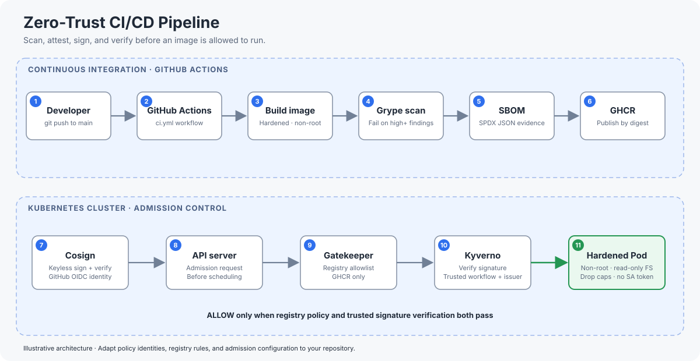
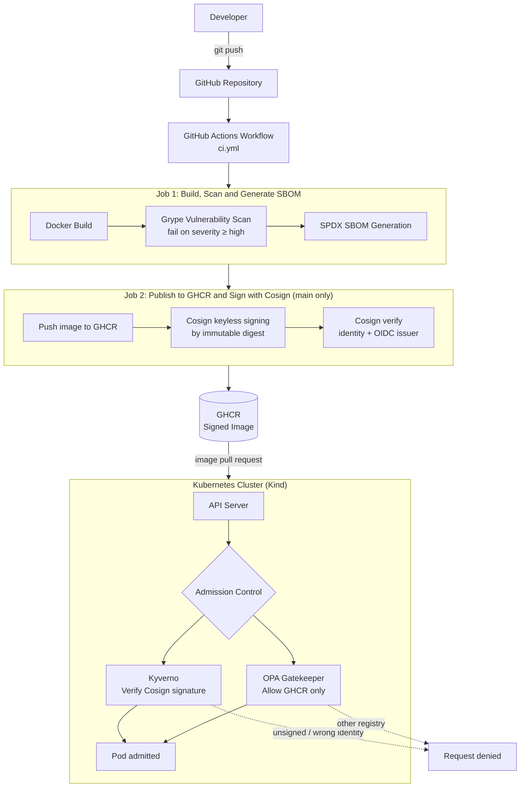
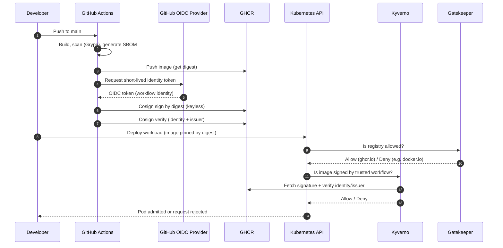

<p align="center">
  
</p>

<h1 align="center">Zero Trust CI/CD Pipeline</h1>

<p align="center">
  Secure • Automated • Cloud Native
</p>


<div align="center">

# 🛡️ Zero-Trust CI/CD Pipeline

**Secure container delivery where nothing is trusted by default — every image is scanned, inventoried, signed, and verified again before it is allowed to run.**


-5A67D8)
-326CE5?logo=kubernetes&logoColor=white)


</div>

---

## Table of Contents

1. [Overview](#1-overview)
2. [Why Zero Trust for CI/CD?](#2-why-zero-trust-for-cicd)
3. [Architecture](#3-architecture)
4. [Technology Stack](#4-technology-stack)
5. [Repository Structure](#5-repository-structure)
6. [The Application and Container Image](#6-the-application-and-container-image)
7. [CI Pipeline (GitHub Actions)](#7-ci-pipeline-github-actions)
8. [Image Signing and Verification](#8-image-signing-and-verification)
9. [Kubernetes Admission Control](#9-kubernetes-admission-control)
10. [Workload Hardening](#10-workload-hardening)
11. [Threat Model: What Each Control Stops](#11-threat-model-what-each-control-stops)
12. [Getting Started](#12-getting-started)
13. [Security Validation and Test Results](#13-security-validation-and-test-results)
14. [Design Decisions and Known Limitations](#14-design-decisions-and-known-limitations)
15. [Roadmap](#15-roadmap)
16. [Glossary](#16-glossary)

---

## 1. Overview

This project is a **DevSecOps portfolio project** that demonstrates an end-to-end *secure software supply chain* for a containerized application.

It answers one question: **"How do we guarantee that only code we built, scanned, and signed can run in our cluster?"**

The pipeline:

1. **Builds** a hardened container image from a small Python service.
2. **Scans** it for known vulnerabilities and **fails the build** on high-severity findings.
3. **Generates an SBOM** (Software Bill of Materials) in SPDX format.
4. **Publishes** the image to GitHub Container Registry (GHCR).
5. **Signs** the image by immutable digest with Cosign using GitHub's OIDC identity (no long-lived signing keys).
6. **Enforces** the result inside Kubernetes: Kyverno verifies the signature, Gatekeeper restricts the registry, and the workload itself runs with a locked-down security context.

## 2. Why Zero Trust for CI/CD?

Traditional pipelines trust whatever lands in a registry. If an attacker pushes a tampered image, or an engineer deploys an image from an untrusted source, the cluster runs it.

Zero Trust replaces *implicit* trust with *continuous verification*:

| Principle | How it is applied here |
|---|---|
| **Never trust, always verify** | The cluster re-verifies the image signature at admission, even though CI already signed it |
| **Verify identity, not location** | Trust is tied to a specific workflow identity (`ci.yml` on `main`), not to "an image in our registry" |
| **No long-lived secrets** | Keyless signing via GitHub Actions OIDC; there is no private signing key to steal |
| **Least privilege** | Non-root, read-only filesystem, no capabilities, no service-account token |
| **Defense in depth** | Independent controls: scan → sign → registry policy → signature policy → hardened runtime |
| **Evidence over assumption** | Scan reports, SBOM, and signing evidence are produced as artifacts for every run |


## Interactive Architecture

Explore the animated architecture to understand how the Zero Trust CI/CD pipeline moves container images through build validation, vulnerability scanning, SBOM generation, image signing, and Kubernetes admission control.

## Zero Trust CI/CD Pipeline Architecture



**[View the Interactive Architecture](https://cloudwithnikhil.github.io/zero-trust-pipeline/zero-trust-ci-cd-pipeline-architecture.html)**

The animation includes three scenarios:

- **Signed image:** Demonstrates the intended successful signature-verification and admission flow.
- **Unsigned image:** Illustrates how the signature policy is intended to reject an unsigned image.
- **Unapproved registry:** Illustrates how Gatekeeper is intended to reject an image from an unapproved registry.

The animation is an architectural demonstration. Actual enforcement behavior is determined by the GitHub Actions workflow and Kubernetes policy manifests in this repository.

## 3. Architecture

### 3.1 High-level flow



### 3.2 Trust chain (sequence)



### 3.3 Defense layers

```
┌──────────────────────────────────────────────────────────────┐
│ Layer 1  SOURCE & BUILD   Hardened Dockerfile, non-root user │
├──────────────────────────────────────────────────────────────┤
│ Layer 2  SCAN & INVENTORY Grype scan (fails build) + SBOM    │
├──────────────────────────────────────────────────────────────┤
│ Layer 3  PROVENANCE       Cosign keyless signature by digest │
├──────────────────────────────────────────────────────────────┤
│ Layer 4  REGISTRY POLICY  Gatekeeper: GHCR only              │
├──────────────────────────────────────────────────────────────┤
│ Layer 5  SIGNATURE POLICY Kyverno: trusted workflow identity │
├──────────────────────────────────────────────────────────────┤
│ Layer 6  RUNTIME          Restricted security context        │
└──────────────────────────────────────────────────────────────┘
```

## 4. Technology Stack

| Area | Tool | Role in this project |
|---|---|---|
| CI/CD | **GitHub Actions** | Orchestrates build, scan, SBOM, publish, and sign |
| Containerization | **Docker** | Builds the application image |
| Base image | **python:3.12-alpine** | Small attack surface |
| Vulnerability scanning | **Grype** | Scans the image; JSON report; fails the build at `high` severity |
| SBOM | **SPDX (JSON)** | Machine-readable inventory of image components |
| Registry | **GHCR** | Stores published images |
| Signing | **Cosign (keyless / Sigstore)** | Signs by digest using GitHub OIDC identity |
| Cluster | **Kubernetes (Kind)** | Local cluster `kind-zero-trust` for admission testing |
| Signature enforcement | **Kyverno** (`ImageValidatingPolicy`) | Rejects images without a valid signature from the trusted workflow |
| Registry enforcement | **OPA Gatekeeper** | Rejects images from non-approved registries |
| Validation | **PowerShell** | Automated security validation and regression tests |

## 5. Repository Structure

```
zero-trust-pipeline/
├── .github/
│   └── workflows/        # GitHub Actions CI pipeline (ci.yml)
├── app/                  # Demo application (server.py)
├── docs/                 # Security validation evidence and results
│   └── security-validation.md
├── kubernetes/           # Workload manifests and admission policies
├── scripts/              # PowerShell validation and regression scripts
│   ├── validate-security.ps1
│   └── test-image-admission.ps1
├── Dockerfile            # Hardened, non-root image definition
├── .dockerignore         # Keeps build context minimal
├── .gitignore            # Excludes local evidence (artifacts/) etc.
└── README.md
```

| Path | Purpose |
|---|---|
| `.github/workflows/` | Defines the two-job pipeline: validate, then publish and sign |
| `app/` | The small Python HTTP service used as the deployable workload |
| `kubernetes/` | Kubernetes resources for the demo workload and the Kyverno/Gatekeeper policies |
| `scripts/` | Repeatable checks that prove the policies actually block bad images |
| `docs/` | Human-readable record of what was tested and what the results were |

## 6. The Application and Container Image

The application is a minimal Python service (`app/server.py`) listening on port **8080** and exposing a **`/health`** endpoint that returns `status: healthy`. It exists to give the pipeline something real to build, sign, and deploy.

### Dockerfile highlights

```dockerfile
FROM python:3.12-alpine3.24

ENV PYTHONDONTWRITEBYTECODE=1 \
    PYTHONUNBUFFERED=1 \
    PORT=8080

RUN addgroup -S -g 10001 appgroup \
 && adduser -S -D -H -u 10001 -G appgroup appuser

WORKDIR /app
COPY --chown=10001:10001 app/server.py ./server.py

USER 10001:10001
EXPOSE 8080
CMD ["python", "server.py"]
```

| Choice | Reason |
|---|---|
| Alpine base, pinned version | Small image, fewer packages to be vulnerable, reproducible builds |
| Dedicated user/group with fixed numeric UID/GID `10001` | Runs as non-root; a numeric ID lets Kubernetes verify `runAsNonRoot` |
| No home directory, no login shell for the user | Minimises what a compromised process can use |
| Only `server.py` is copied | No build tooling, source tree, or secrets in the final image |
| `PYTHONDONTWRITEBYTECODE=1` | No `.pyc` writes, which suits a read-only root filesystem |
| `PYTHONUNBUFFERED=1` | Logs appear immediately in `docker logs` / `kubectl logs` |

## 7. CI Pipeline (GitHub Actions)

The workflow (`.github/workflows/ci.yml`) has two jobs. The second only runs after the first succeeds.

### Job 1 — Build, Scan and Generate SBOM

1. Build the container image.
2. Scan it with **Grype** (`severity-cutoff: high`, `fail-build: true`). A finding at or above the cutoff **fails the pipeline**, so a vulnerable image never reaches the registry.
3. Generate an **SPDX JSON SBOM** listing every component in the image.
4. Write build, SBOM, and scan outcomes to the **GitHub job summary**.

### Job 2 — Publish to GHCR and Sign with Cosign

Runs on **pushes to `main`** after Job 1 passes.

1. Publish the validated image to **GHCR**.
2. Sign it with **Cosign** using the immutable **digest** (not a mutable tag).
3. **Verify** the signature against the expected workflow identity and OIDC issuer.

### Workflow artifacts

| Artifact | Purpose |
|---|---|
| `security-evidence` | Grype JSON vulnerability report |
| `zero-trust-demo-sbom` | SPDX JSON SBOM |
| `validated-container-image` | The image that passed validation |
| `image-signing-evidence` | Cosign signing and verification evidence |

> **Tip:** After a run, open the job summary for a quick overview and download the artifacts from the **Actions** tab for the full reports.

## 8. Image Signing and Verification

Signing is **keyless** (Sigstore). Instead of storing a private key as a secret, the workflow asks GitHub's OIDC provider for a short-lived identity token that proves *"this signature was produced by this workflow in this repository."*

| Property | Value |
|---|---|
| Expected signer identity | `https://github.com/cloudwithnikhil/zero-trust-pipeline/.github/workflows/ci.yml@refs/heads/main` |
| Expected OIDC issuer | `https://token.actions.githubusercontent.com` |
| What is signed | The image **digest** (immutable) |

**Why this matters**

- There is **no signing key to leak** or rotate.
- A signature from any *other* workflow, branch, or repository is rejected, even if it is technically valid.
- Signing by digest prevents "tag swap" attacks, where a tag is silently repointed to different content.

## 9. Kubernetes Admission Control

Two independent controllers decide whether a Pod may start. They are deliberately separate so that a failure or bypass of one does not disable the other.

### 9.1 Kyverno — signature verification

| Item | Value |
|---|---|
| Resource | `ImageValidatingPolicy` |
| Policy name | `verify-zero-trust-demo` |
| Verifies | Cosign signature, signer identity, and OIDC issuer (see section 8) |
| Denial message | `Image must have a valid Cosign signature from the trusted GitHub Actions workflow.` |

An image within the protected repository scope that is unsigned, or signed by the wrong identity, is rejected.

### 9.2 OPA Gatekeeper — registry allow-list

| Item | Value |
|---|---|
| Constraint name | `allow-ghcr-only` |
| Behavior | Rejects any image not pulled from GHCR |
| Verified by | Denial of `docker.io/library/nginx:latest` |

### 9.3 Environment

| Item | Value |
|---|---|
| Kubernetes context | `kind-zero-trust` |
| Namespace | `zero-trust-demo` |
| Service exposure | Internal `ClusterIP` only |
| Image reference | Pinned to an immutable digest |

## 10. Workload Hardening

The application Deployment is configured to follow Kubernetes security best practice:

| Setting | Effect |
|---|---|
| Run as non-root | A compromised process does not run as root |
| Read-only root filesystem | Attackers cannot modify binaries or drop files on disk |
| Privilege escalation disabled | Blocks `setuid`-style escalation |
| All Linux capabilities dropped | Minimal kernel privileges |
| Service-account token automount disabled | No Kubernetes API credentials inside the Pod |
| CPU and memory limits | Limits resource-exhaustion impact |
| `ClusterIP` Service | Not exposed outside the cluster |

## 11. Threat Model: What Each Control Stops

| Threat | Control that mitigates it |
|---|---|
| Image contains a known high-severity vulnerability | Grype scan fails the build |
| Unknown or undocumented dependencies in the image | SPDX SBOM for every build |
| Attacker pushes a tampered image to the registry | Kyverno rejects it: no valid signature |
| Someone signs an image with a different identity or repo | Kyverno checks signer identity and issuer |
| Mutable tag is repointed to malicious content | Signing and admission use the immutable digest |
| Engineer deploys an image from a public or untrusted registry | Gatekeeper `allow-ghcr-only` |
| Signing key is stolen | No long-lived key exists (keyless / OIDC) |
| Container compromise leads to host or cluster pivot | Non-root, read-only FS, no capabilities, no token, resource limits |
| Compromised Pod is reachable from outside | `ClusterIP`-only Service |

## 12. Getting Started

### Prerequisites

- Docker
- [Kind](https://kind.sigs.k8s.io/) and `kubectl`
- PowerShell (the validation scripts are `.ps1`)
- Kyverno and OPA Gatekeeper installed in the cluster
- A GitHub repository with Actions and GHCR packages enabled (to reproduce the CI side)

### Run the application locally

```bash
docker build -t zero-trust-demo .
docker run --rm -p 8080:8080 zero-trust-demo

curl http://localhost:8080/health
```

### Prepare the cluster

```bash
# Create the local cluster (context becomes kind-zero-trust)
kind create cluster --name zero-trust

# Install Kyverno and Gatekeeper using their official install guides,
# then apply the manifests in the kubernetes/ directory.
```

> Apply order matters: install the Kyverno and Gatekeeper controllers first, create the Gatekeeper constraint template before its constraint, then deploy the workload.

### Verify a published image yourself

```bash
cosign verify ghcr.io/cloudwithnikhil/zero-trust-pipeline@<digest> \
  --certificate-identity "https://github.com/cloudwithnikhil/zero-trust-pipeline/.github/workflows/ci.yml@refs/heads/main" \
  --certificate-oidc-issuer "https://token.actions.githubusercontent.com"
```

## 13. Security Validation and Test Results

### Run the tests

From the repository root:

```powershell
# Full validation suite
.\scripts\validate-security.ps1

# Focused image-admission regression tests
.\scripts\test-image-admission.ps1
```

- Both scripts require the intended Kind cluster and admission controllers.
- The regression script confirms the active context is `kind-zero-trust` before running.
- Admission tests use `kubectl create --dry-run=server`, so **no persistent test Pods are created**.

### Latest result: 8 passed, 0 failed

| # | Check | Result | Evidence |
|---|---|---|---|
| 1 | Kyverno image-verification policy | ✅ Passed | `conditionStatus.ready: true` |
| 2 | Gatekeeper controller | ✅ Passed | Controller Deployment has an available replica |
| 3 | Application Deployment | ✅ Passed | At least one available replica |
| 4 | Workload security context | ✅ Passed | Non-root, read-only FS, no privilege escalation, capabilities dropped, token automount off, limits set |
| 5 | Health endpoint | ✅ Passed | `/health` returned `status: healthy` |
| 6 | Registry restriction | ✅ Passed | Gatekeeper denied `docker.io/library/nginx:latest` |
| 7 | Unsigned image admission | ✅ Rejected as expected | Kyverno denied an unsigned image in the protected repository scope |
| 8 | Trusted signed image admission | ✅ Accepted as expected | Admitted during a server-side dry run |

### Negative-test notes (what was and was not proven)

| Observation | What it means |
|---|---|
| Unsigned image from the protected repo was denied with the signature-policy message | **Valid** proof of signature enforcement |
| Image signed under an intentionally wrong identity was denied | **Valid** proof that signer identity is checked (temporary policy removed afterwards) |
| A nonexistent tag was denied (`MANIFEST_UNKNOWN`) | **Not** proof of signature enforcement; the registry simply had no such image |
| An image outside Kyverno's configured scope was accepted | Expected; it did not test signature rejection |

Full detail is in [`docs/security-validation.md`](docs/security-validation.md).

## 14. Design Decisions and Known Limitations

**Design decisions**

- **Two controllers, not one.** Kyverno (signature) and Gatekeeper (registry) cover different questions and are tested independently.
- **Digest pinning.** Digests cannot be silently repointed, unlike tags.
- **Keyless signing.** Removes key management and ties trust to a workflow identity.
- **Fail closed on scan results.** A high-severity finding stops the release.
- **Dry-run admission tests.** Prove policy behavior without leaving test workloads behind.

**Limitations**

- Admission tests run against a **local Kind cluster** and are **separate from CI**; they must be re-run independently.
- Automated validation checks current cluster state and does not replace reviewing policy definitions, scan findings, and signing evidence.
- Local `artifacts/` evidence is excluded from Git; publish only sanitized evidence on purpose.
- Scope is a single demo workload and a single namespace.

## 15. Roadmap

- [ ] Run admission regression tests in CI against an ephemeral Kind cluster
- [ ] Attach and verify SBOM and provenance attestations (SLSA) at admission
- [ ] Add secret scanning and static analysis stages
- [ ] Add a GitOps deployment flow (e.g., Argo CD or Flux)
- [ ] Add runtime threat detection (e.g., Falco)
- [ ] Add Pod Security Admission and NetworkPolicies
- [ ] Add a repository `LICENSE`

## 16. Glossary

| Term | Meaning |
|---|---|
| **Zero Trust** | Security model with no implicit trust; every request or artifact is verified |
| **SBOM** | Software Bill of Materials: an inventory of all components in a build |
| **SPDX** | An open, standard SBOM format |
| **Grype** | Open-source vulnerability scanner for container images and filesystems |
| **Cosign / Sigstore** | Tooling for signing and verifying container images |
| **Keyless signing** | Signing with a short-lived identity certificate from OIDC instead of a stored private key |
| **OIDC** | OpenID Connect; GitHub Actions uses it to prove a workflow's identity |
| **Digest** | Immutable content hash of an image (`sha256:...`) |
| **GHCR** | GitHub Container Registry |
| **Kyverno** | Kubernetes-native policy engine; here it verifies image signatures |
| **OPA Gatekeeper** | Policy controller for Kubernetes admission using Open Policy Agent |
| **Admission control** | Kubernetes checks that approve or reject resources before they are stored and run |
| **Kind** | "Kubernetes in Docker"; a local cluster for testing |

---

<div align="center">

**Author:** [cloudwithnikhil](https://github.com/cloudwithnikhil)

</div>