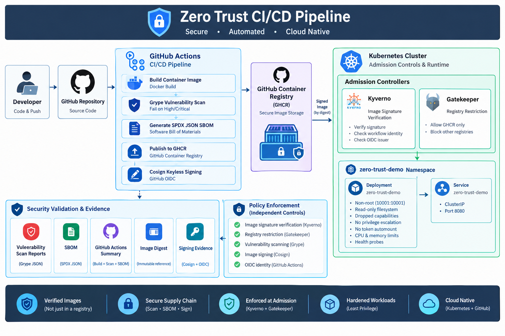
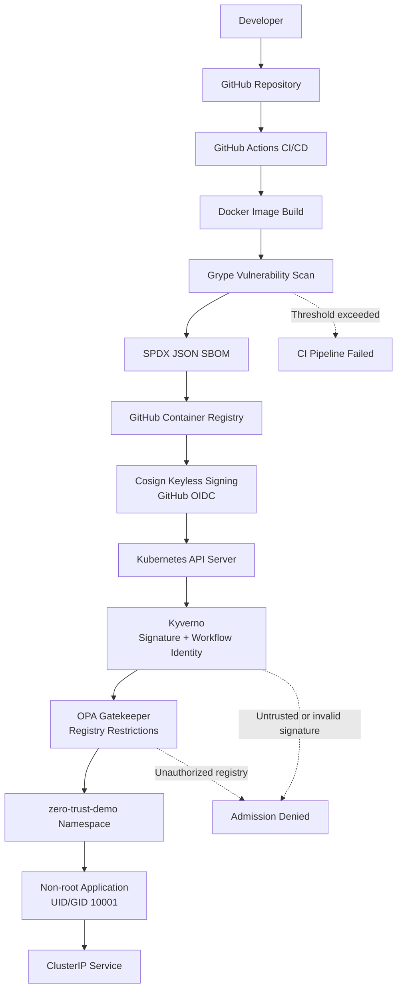

<h1 align="center">Zero Trust CI/CD Pipeline</h1>

> **A security-first software delivery architecture that builds, validates, signs, and deploys trusted container images to Kubernetes.**

<p align="center">
  **Secure Software Supply Chain · Automated Security Validation · Zero-Trust Deployment**
</p>


---

## 1. Overview

Modern CI/CD pipelines automate application builds and deployments, but automation alone does not guarantee security.

A container image may contain vulnerable dependencies, originate from an untrusted build process, or be deployed from an unauthorized registry. Simply storing an image in a private registry or successfully completing a CI/CD workflow does not make that image trustworthy.

This project demonstrates a **Zero-Trust CI/CD Pipeline** that introduces independent security verification throughout the software delivery lifecycle.

The pipeline follows a simple principle:

**Never trust an artifact by default. Verify its security, integrity, origin, and identity before allowing it to run.**

The architecture integrates:

- GitHub Actions for CI/CD automation.
- Docker for container image creation.
- Grype for vulnerability scanning.
- SPDX JSON for Software Bill of Materials (SBOM) generation.
- GitHub Container Registry (GHCR) for image storage.
- Cosign for keyless container image signing.
- GitHub Actions OIDC for workload identity.
- Kyverno for image signature and workflow identity verification.
- OPA Gatekeeper for container registry restrictions.
- Kubernetes for deployment and runtime isolation.

It also applies container-level security controls to reduce the impact of a compromised application.

## 2. Architecture Objectives

The main objective is to ensure that only approved and verifiable container images can enter the Kubernetes environment.

| Security objective | Implementation |
|---|---|
| Automated software delivery | GitHub Actions |
| Container isolation | Docker |
| Vulnerability detection | Grype |
| Software transparency | SPDX JSON SBOM |
| Artifact distribution | GitHub Container Registry |
| Artifact authenticity | Cosign |
| Build identity verification | GitHub Actions OIDC |
| Signature enforcement | Kyverno |
| Registry restrictions | OPA Gatekeeper |
| Runtime isolation | Kubernetes security context |
| Resource protection | CPU and memory requests and limits |
| Application health | Liveness and readiness probes |

### Core Zero-Trust principles

1. **Verify explicitly:** Validate image signatures and trusted workflow identities.
2. **Use least privilege:** Limit permissions for CI/CD identities and application containers.
3. **Assume breach:** Treat images and deployment requests as untrusted until verified.
4. **Enforce at deployment:** Apply security policies through Kubernetes admission control.
5. **Maintain traceability:** Associate deployed images with their source and build identity.

## 3. High-Level Architecture

The complete software delivery process is divided into six stages:

1. Source code management.
2. Continuous integration and container build.
3. Vulnerability scanning and SBOM generation.
4. Image publishing and keyless signing.
5. Kubernetes admission verification.
6. Secure application deployment.



The diagram shows the logical security flow. Actual job dependencies and admission evaluation order are determined by the GitHub Actions workflow and Kubernetes admission configuration.

## 4. Detailed Architecture Components

### 4.1 Developer and GitHub Repository

The process begins when a developer pushes application code or creates a pull request in the GitHub repository.

GitHub acts as the central source-control platform and provides version history, collaboration, and workflow triggers.

**Responsibilities:**

- Maintain application source code.
- Track changes through Git.
- Trigger automated CI/CD workflows.
- Maintain version history.
- Support code reviews and controlled releases.

**Security considerations:**

- Protect important branches.
- Review changes to CI/CD workflows.
- Avoid committing passwords, tokens, and private keys.
- Restrict repository and workflow permissions.
- Use approved GitHub Actions and pin dependencies appropriately.

The source repository is the starting point of the software supply chain. Its contents must still pass the required validation stages.

### 4.2 GitHub Actions – CI/CD Automation

GitHub Actions coordinates the software delivery lifecycle.

When a configured repository event occurs, the workflow executes the required jobs and steps.

Its responsibilities include:

- Checking out the source code.
- Building the Docker image.
- Running Grype vulnerability scanning.
- Generating the SPDX JSON SBOM.
- Publishing the validated image to GHCR.
- Requesting an OIDC identity token.
- Signing the image using Cosign.

The pipeline should use minimum required permissions, especially for package publishing and OIDC token generation.

For keyless signing, the workflow requires the appropriate OIDC permission:

```yaml
permissions:
  contents: read
  packages: write
  id-token: write
```

The actual permission set should be kept as restrictive as the workflow allows.

### 4.3 Docker – Container Image Build

Docker packages the application and its required dependencies into a container image.

The image provides a consistent application environment that can be tested and deployed across different infrastructure environments.

The build stage should produce a versioned image that can be traced back to its source revision.

For example:

```text
ghcr.io/OWNER/zero-trust-demo:COMMIT_SHA
```

For deployment and verification, an immutable digest reference is preferable:

```text
ghcr.io/OWNER/zero-trust-demo@sha256:IMAGE_DIGEST
```

**Why image digests matter:**

Image tags are mutable references. A tag can point to different image content over time.

A digest identifies a specific image and helps ensure that the image verified during admission is the same artifact intended for deployment.

### 4.4 Grype – Vulnerability Scanning

Grype is used to identify known vulnerabilities in the container image and its supported software components.

It evaluates the image against vulnerability information and reports findings with severity levels.

Typical findings include:

- Critical vulnerabilities.
- High-severity vulnerabilities.
- Medium-severity vulnerabilities.
- Low-severity vulnerabilities.
- Vulnerable operating system packages.
- Vulnerable application dependencies.

The project configures a vulnerability severity threshold.

**Expected behavior:**

| Finding | Pipeline behavior |
|---|---|
| No findings above the configured threshold | Continue |
| Finding meets the configured failure threshold | Fail the security gate |
| Scanner execution fails | Handle according to the configured CI failure policy |

The precise behavior depends on the Grype command and workflow exit-code configuration.

**Why vulnerability scanning matters:**

A container image can build successfully while still containing vulnerable software. Scanning provides an automated security checkpoint before the artifact is approved for publishing.

A successful scan does not guarantee that an image is completely free of vulnerabilities. It means that the image passed the configured checks against the vulnerability data available to the scanner.

### 4.5 SPDX JSON – Software Bill of Materials

A Software Bill of Materials (SBOM) is a structured inventory of software components included in an application or container image.

This project generates an SBOM in SPDX JSON format.

The SBOM can provide information about:

- Software packages.
- Package versions.
- Component identifiers.
- Dependencies.
- Package relationships.
- Licensing information, where available.

**Example conceptual workflow:**

```text
Docker Image
     |
     v
SBOM Generation
     |
     v
SPDX JSON Document
     |
     v
Component Inventory
```

**Why SBOM matters:**

When a new vulnerability is disclosed, the SBOM helps determine whether the affected package or dependency exists in the application image.

It also improves software supply-chain transparency and supports vulnerability investigation.

The SBOM should be retained and associated with the exact image digest it describes.

### 4.6 GitHub Container Registry (GHCR)

GitHub Container Registry stores and distributes the container image produced by the CI/CD pipeline.

It acts as the artifact repository between the build environment and Kubernetes.

The registry stores the image under a repository-specific reference.

Example:

```text
ghcr.io/OWNER/zero-trust-demo:COMMIT_SHA
```

Images can also be referenced using their immutable digests.

**Responsibilities:**

- Store container images.
- Distribute images to Kubernetes.
- Provide authenticated package access.
- Maintain image versions and associated metadata.

**Security considerations:**

- Use authenticated registry access.
- Restrict package publishing permissions.
- Avoid exposing private images unnecessarily.
- Protect release artifacts.
- Use immutable digests for deployment verification.

A private registry is not automatically a trusted source. Image authenticity must still be independently verified.

### 4.7 Cosign – Keyless Image Signing

Cosign is used to sign the container image after it has passed the configured validation stages.

This project uses **keyless signing with GitHub Actions OIDC**.

Unlike traditional key-based signing, keyless signing can establish signing identity through a short-lived identity token rather than requiring a long-lived private signing key to be stored in the CI/CD environment.

**Signing workflow:**

1. GitHub Actions requests an OIDC identity token.
2. The signing process uses the token to establish the workflow identity.
3. Cosign performs the image-signing operation.
4. The signature is associated with the image digest.
5. The resulting signature and certificate information can be verified later.

The trusted identity can include information about the GitHub repository and workflow that performed the signing.

**Why keyless signing matters:**

A container image should not be trusted merely because it exists in GHCR.

The signature provides cryptographic evidence that the artifact was signed by an identity that can be independently checked.

**Important:** A valid signature proves that an artifact was signed by the associated identity. It does not independently prove that the image contains no vulnerabilities or malicious code.

### 4.8 GitHub OIDC – Workload Identity

OpenID Connect (OIDC) allows GitHub Actions to obtain an identity token for supported external integrations.

In this architecture, OIDC provides the identity used for keyless Cosign signing.

The signing identity can be checked against the expected GitHub repository and workflow identity during Kubernetes admission.

This avoids relying solely on a manually managed long-lived signing key.

**Security benefits:**

- Reduces dependence on persistent private signing keys.
- Establishes the identity of the signing workflow.
- Supports verification of trusted build origins.
- Improves signing identity traceability.

The expected identity must be configured consistently in the signing process and Kyverno verification policy.

## 5. Kubernetes Zero-Trust Admission Control

After the image has been published and signed, Kubernetes becomes the final enforcement point before the application is allowed to run.

The Kubernetes API server receives the deployment request and processes the configured admission controls.

This architecture uses two complementary policy engines:

- Kyverno for signature and workflow identity verification.
- OPA Gatekeeper for container registry restrictions.

### 5.1 Kyverno – Image Signature and Identity Verification

Kyverno is a Kubernetes-native policy engine that validates resources during admission.

The project uses Kyverno to verify that the requested container image has an acceptable signature and originates from the expected signing workflow identity.

**Kyverno verifies:**

- Whether the image has a signature.
- Whether the signature is cryptographically valid.
- Whether the signing identity is trusted.
- Whether the workflow identity matches the configured requirements.
- Whether the image digest satisfies verification requirements.

**Expected behavior:**

| Image condition | Expected result |
|---|---|
| Valid signature from trusted workflow | Allow |
| Unsigned image | Deny |
| Invalid signature | Deny |
| Signature from untrusted identity | Deny |
| Image fails verification requirements | Deny |

The policy must be configured for the actual GHCR image reference and expected GitHub Actions signing identity.

**Why Kyverno matters:**

Even if someone manually publishes an image to GHCR, the image should not be admitted unless it satisfies the signature verification requirements.

This creates an independent security check at deployment time.

### 5.2 OPA Gatekeeper – Registry Restrictions

OPA Gatekeeper is a Kubernetes policy enforcement system built around Open Policy Agent (OPA).

It uses policy constraints to control which resources are permitted in the cluster.

In this project, Gatekeeper restricts the container registries from which workloads can use images.

For example:

```text
Approved registry:
ghcr.io/

Unapproved registries:
docker.io/
untrusted-registry.example/
```

The actual allowlist should be configured to match the project's intended registry scope.

**Expected behavior:**

| Image source | Expected result |
|---|---|
| Approved GHCR image | Allow, subject to other policies |
| Unauthorized registry | Deny |
| Image from an unapproved source | Deny |

**Why Gatekeeper matters:**

Signature verification and registry authorization solve different problems.

Kyverno verifies the authenticity of the image and its signing identity. Gatekeeper restricts where images are allowed to originate.

Together, they establish independent admission requirements.

### 5.3 Kyverno vs OPA Gatekeeper

| Responsibility | Kyverno | OPA Gatekeeper |
|---|---|---|
| Image signature verification | Yes | Not its primary purpose |
| Trusted signing identity verification | Yes | Not its primary purpose |
| Registry allowlist enforcement | Possible | Yes, in this implementation |
| Kubernetes admission policies | Yes | Yes |
| Rego-based custom constraints | No | Yes |

The policies should be designed together to avoid conflicting rules and duplicated enforcement.

## 6. Secure Kubernetes Workload

Once the deployment request passes the required admission checks, Kubernetes can create the application workload in the `zero-trust-demo` namespace.

The application container is configured with additional runtime security controls.

These controls reduce unnecessary privileges and help limit the impact of a compromised application.

### 6.1 Non-root Container Execution

The application runs using a dedicated non-root user and group:

```text
UID: 10001
GID: 10001
```

Running as a non-root user reduces the privileges available to processes inside the container.

### 6.2 Read-only Root Filesystem

The container root filesystem is configured as read-only.

This helps prevent application processes from modifying the container filesystem at runtime.

Applications that require writable temporary storage should use explicitly configured writable volumes.

### 6.3 Dropped Linux Capabilities

Linux capabilities divide traditional root privileges into smaller permission units.

The application drops unnecessary capabilities to reduce its available privileges.

This limits the potential impact of a compromised application process.

### 6.4 Disabled Privilege Escalation

Privilege escalation is disabled for the application container.

This prevents processes from gaining additional privileges through supported escalation mechanisms.

### 6.5 Disabled Automatic Service Account Token Mounting

Automatic mounting of the Kubernetes service account token is disabled.

If the application does not need to communicate with the Kubernetes API, it should not receive an unnecessary service account token.

This reduces the risk of unauthorized access to Kubernetes API resources from a compromised container.

### 6.6 CPU and Memory Requests and Limits

The application defines Kubernetes resource requests and limits.

| Resource setting | Purpose |
|---|---|
| CPU request | Defines the CPU resource required for scheduling |
| Memory request | Defines the memory requirement for scheduling |
| CPU limit | Restricts CPU consumption |
| Memory limit | Restricts memory consumption |

These controls help prevent one application from consuming excessive cluster resources.

The actual values should be configured according to application workload requirements.

### 6.7 Liveness and Readiness Probes

Kubernetes health probes monitor application availability.

**Liveness probe**

Checks whether the application is still functioning.

If the application becomes unhealthy according to the configured probe, Kubernetes can restart the affected container.

**Readiness probe**

Checks whether the application is ready to receive traffic.

If the readiness check fails, Kubernetes removes the Pod from the Service's eligible endpoints until it becomes ready again.

These probes improve application availability and help Kubernetes manage unhealthy workloads.

### 6.8 ClusterIP Service

The application is exposed internally through a Kubernetes ClusterIP Service.

```text
Service: zero-trust-demo
Type: ClusterIP
Port: 8080
```

A ClusterIP Service provides internal cluster networking.

It does not directly expose the application to the public internet. External access would require an additional component such as an Ingress controller, gateway, or load balancer.

## 7. Complete CI/CD Execution Flow

The following steps describe the complete application delivery lifecycle.

### Stage 1 – Code Push

A developer pushes changes to the GitHub repository.

The configured GitHub Actions workflow is triggered.

### Stage 2 – Container Build

GitHub Actions checks out the source code and builds the Docker image.

The image receives an appropriate version or commit-based tag.

### Stage 3 – Vulnerability Scanning

Grype scans the generated container image.

If the configured High/Critical severity threshold is met, the pipeline fails according to the configured exit-code behavior.

An image that fails this security gate must not be treated as an approved release artifact.

### Stage 4 – SBOM Generation

The pipeline generates an SPDX JSON SBOM.

This document provides a structured inventory of the software components contained in the image.

### Stage 5 – Image Publishing

The validated image is published to GitHub Container Registry.

The image digest provides a stable reference to the exact artifact.

### Stage 6 – Keyless Signing

Cosign uses GitHub Actions OIDC to establish the workflow signing identity and sign the image.

The signature is associated with the image digest.

### Stage 7 – Kubernetes Deployment Request

The deployment process submits a Kubernetes resource that references the intended container image.

The Kubernetes API server begins admission processing.

### Stage 8 – Kyverno Verification

Kyverno verifies the image signature and the configured trusted workflow identity.

If the image is unsigned, invalid, or signed by an untrusted identity, admission is rejected.

### Stage 9 – Gatekeeper Policy Validation

Gatekeeper checks whether the container image originates from an approved registry.

An unauthorized registry results in an admission rejection.

### Stage 10 – Secure Workload Creation

When the required admission policies pass, Kubernetes accepts the workload.

The application runs in the `zero-trust-demo` namespace with the configured runtime security controls.

## 8. Security Boundaries

The architecture uses multiple independent security boundaries.

| Boundary | Security mechanism | Objective |
|---|---|---|
| Developer → GitHub | Repository access and branch protection | Protect source code |
| GitHub → CI/CD | Workflow permissions | Control pipeline execution |
| CI/CD → Container build | Controlled build workflow | Protect artifact creation |
| Build → Security validation | Grype and SBOM | Identify vulnerabilities and components |
| CI/CD → GHCR | Authenticated package publishing | Protect artifact storage |
| CI/CD → Signing | GitHub OIDC and Cosign | Establish artifact signing identity |
| GHCR → Kubernetes | Kyverno | Verify image authenticity |
| Image source → Kubernetes | Gatekeeper | Restrict permitted registries |
| Kubernetes → Application | Container security context | Reduce runtime privileges |

A failure at a mandatory security boundary should prevent an unapproved artifact from progressing.

## 9. Security Validation Scenarios

A Zero Trust architecture must demonstrate both successful and rejected deployment scenarios.

### Positive test cases

These confirm that approved workloads can be deployed successfully.

| Test | Expected result |
|---|---|
| Validly signed GHCR image | Deployment allowed |
| Trusted GitHub Actions signing identity | Verification succeeds |
| Image from approved registry | Registry policy passes |
| Secure application configuration | Workload accepted |

### Negative test cases

These confirm that security policies reject untrusted artifacts.

| Test | Expected result |
|---|---|
| Unsigned image | Rejected by Kyverno |
| Invalid image signature | Rejected by Kyverno |
| Untrusted signing identity | Rejected by Kyverno |
| Image from unauthorized registry | Rejected by Gatekeeper |
| Vulnerability scan reaches configured failure threshold | CI security gate fails |

Both test categories are important.

A policy that rejects every deployment is not a successful implementation. The architecture must demonstrate that valid workloads are accepted and invalid workloads are rejected.

**Validation note:** Expected results describe the intended behavior. Actual test evidence should be recorded separately in `security-validation.md`.

## 10. Secrets and Identity Management

The pipeline uses several identities and credentials that must be protected.

Important security-sensitive resources include:

- GitHub repository credentials.
- GHCR package publishing permissions.
- GitHub OIDC identity permissions.
- Kubernetes deployment permissions.
- Cluster administrator credentials, where applicable.

Recommended practices:

1. Avoid storing credentials directly in source code.
2. Use GitHub Secrets for required sensitive configuration.
3. Apply least-privilege workflow permissions.
4. Restrict who can modify signing and deployment workflows.
5. Prefer short-lived identity-based authentication.
6. Avoid exposing sensitive values in CI/CD logs.
7. Protect Kubernetes cluster access.
8. Review and audit access to registries and deployment environments.

A keyless signing design reduces dependence on long-lived signing keys, but it does not remove the need to protect the GitHub repository, workflow definitions, and OIDC trust configuration.

## 11. Monitoring and Auditability

A secure CI/CD system must provide enough information to investigate failed builds, rejected images, and deployment issues.

Recommended monitoring sources:

| Component | Information to monitor |
|---|---|
| GitHub Actions | Workflow execution and job failures |
| Grype | Vulnerability findings |
| SBOM | Component inventory and release association |
| GHCR | Image publishing and access |
| Cosign | Image signing and verification results |
| Kyverno | Signature verification and policy violations |
| Gatekeeper | Constraint violations |
| Kubernetes | Pod events and workload health |

These records can be integrated with a centralized logging and monitoring solution.

The objective is to maintain traceability from source-code changes through image creation and signing to Kubernetes admission.

## 12. Current Deployment Configuration

The reference implementation uses the following Kubernetes configuration.

| Property | Configuration |
|---|---|
| Namespace | `zero-trust-demo` |
| Deployment | `zero-trust-demo` |
| Service | `zero-trust-demo` |
| Service type | `ClusterIP` |
| Application port | `8080` |
| Container UID | `10001` |
| Container GID | `10001` |
| Container execution | Non-root |
| Root filesystem | Read-only |
| Linux capabilities | Dropped |
| Privilege escalation | Disabled |
| Service account token | Automatic mounting disabled |
| Resource management | CPU and memory requests and limits |
| Health monitoring | Liveness and readiness probes |

These values describe the current documented deployment configuration. Resource quantities, probe paths, and other detailed settings are defined in the corresponding Kubernetes manifests.

## 13. Production Readiness Considerations

This project demonstrates important Zero Trust controls, but a production implementation requires additional operational safeguards.

### Supply Chain Security

- Generate and retain SBOMs for every released image.
- Associate SBOMs with immutable image digests.
- Consider signed build provenance and attestations.
- Protect release workflows.
- Establish a vulnerability remediation process.

### Identity and Access Management

- Use dedicated CI/CD identities.
- Restrict package publishing permissions.
- Separate staging and production deployment access.
- Review OIDC trust conditions.
- Protect Kubernetes API credentials.

### Kubernetes Security

- Enforce admission policies.
- Apply Pod Security Standards.
- Restrict privileged containers.
- Configure network policies where required.
- Use least-privilege service accounts.
- Secure cluster and control-plane access.

### Reliability and Recovery

- Monitor Kyverno and Gatekeeper availability.
- Define policy failure behavior.
- Maintain backups of important cluster configuration.
- Test deployment rollback and recovery.
- Establish a controlled policy exception process.

### Policy Governance

- Store policies in version control.
- Review policy changes through pull requests.
- Test policies before production enforcement.
- Record exceptions and their expiry dates.
- Regularly review policy violations.

## 14. Key Benefits

**Stronger software supply-chain security**

The pipeline combines vulnerability scanning, SBOM generation, and cryptographic image signing.

**Independent artifact verification**

Kubernetes admission control verifies image signatures and trusted workflow identities instead of relying solely on CI/CD success.

**Controlled image sources**

Gatekeeper restricts workloads to approved container registries.

**Reduced runtime privileges**

The application runs as a non-root user with a read-only root filesystem, dropped capabilities, and restricted privilege escalation.

**Improved resource protection**

CPU and memory limits help prevent uncontrolled resource consumption.

**Better application availability**

Liveness and readiness probes allow Kubernetes to respond to application health changes.

**Improved traceability**

The image digest, signing identity, SBOM, and admission results provide useful evidence across the delivery lifecycle.

## 15. Conclusion

This Zero-Trust CI/CD Pipeline demonstrates how security can be integrated into the complete container software delivery lifecycle.

The architecture does not assume that a container image is trustworthy simply because it was successfully built or published to a private registry.

Instead, it introduces multiple independent controls:

- Grype checks for known vulnerabilities.
- SPDX JSON provides software component visibility.
- GHCR stores the container image.
- Cosign signs the image using GitHub Actions OIDC.
- Kyverno verifies image signatures and trusted workflow identities.
- OPA Gatekeeper enforces approved registry restrictions.
- Kubernetes applies runtime security controls to the application.

Together, these controls establish a more secure and verifiable application delivery process.

**Build securely. Scan continuously. Sign with trusted identity. Verify independently. Deploy only approved artifacts.**

---

## Project Scope and Disclaimer

This repository is an engineering reference implementation demonstrating Zero Trust principles for container-based CI/CD and Kubernetes deployments.

The architecture describes the intended responsibilities of each security component. Actual enforcement depends on the configured GitHub Actions workflow, Grype threshold, SBOM generation, Cosign signing identity, GHCR permissions, Kyverno policies, Gatekeeper constraints, and Kubernetes manifests.

A successful build or deployment alone does not establish that every security control has been tested. Positive and negative admission tests, runtime configuration checks, and operational validation should be documented separately.